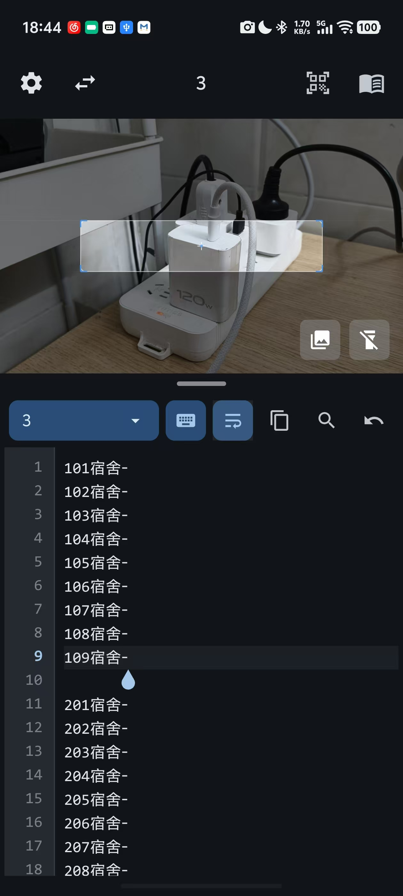
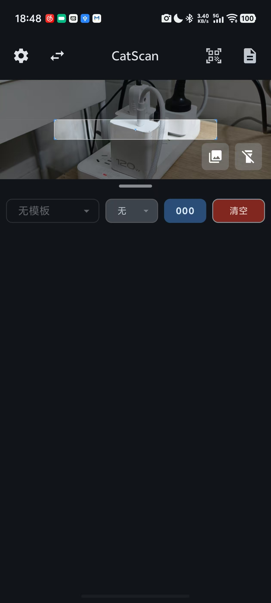

# CatScan

CatScan 是一套 Android + Windows 的局域网扫码采集工具。Android 端除双通道二维码扫描外，还内置**中文文字识别（OCR）内核**——摄像头对准文字行直接提取编号，或从相册选图后用 Big Bang 涂抹选词自由摘录片段；配合模板游标与文档编辑器完成采集，Windows 端接收实时镜像，可用于检索、导出和自动输入。

## 截图

| 文档模式 | 模板模式 |
| --- | --- |
|  |  |

## 核心功能

### 扫码与模板

- CameraX 相机预览 + 双通道识别：通道 1 用 ML Kit 全帧直扫（可配置采样间隔），通道 2 用 OpenCV 候选区裁剪后再识别，兼顾远距离大图与近距离小码；识别结果带多帧稳定器防抖动
- **文字识别内核（OCR）**：设置中一键切换，与二维码内核正交，支持录入模式与文档/模板两条路径：
  - 内置中文+拉丁识别模型，无需 Google Play 服务；全帧识别按 200ms 节流，识别区中央横线对准目标行即可
  - 录入规则默认 8~15 位纯数字，可在正则弹窗中切换内置模板（纯数字/字母数字/前缀+数字/手机号/邮箱）或自定义（左下角正则按钮或识别区底部规则标签均可进入）；**不填规则则整行录入**
  - 重复内容防抖：同一内容短时间内不重复录入，扫描线只在命中规则时短暂变绿
  - 相册图片 OCR → **Big Bang 涂抹选词**：识别结果按系统 ICU 词典拆成词块铺开（正则命中块高亮），单击切换选中、按住涂抹按起点状态批量加/取消选中，选中的词块拼成一行进入下方缓存列表（可逐行编辑、删除），点确定按顺序逐条走扫码链路录入；弹窗期间自动挂起相机预览省电
- 模板分两种录入模式，可随时来回切换（切换不影响已有记录）：
  - **房间号模板**：按 楼层 → 房间 → 标签 三层游标自动推进（标签推进最快，一轮用完进下一房间/楼层）；楼层数、每层房间数、精细勾选房间均可配置
  - **序号模板**：自定义前缀 + 序号 + 后缀，支持数字/中文大写数字、正序/倒序、固定位数或按总量自动补零（10 条 01 起、100 条 001 起）；配置标签时按 标签 → 序号 轮询（01甲 → 01乙 → 02甲…）
- 标签系统：每个模板可建任意多个标签并指定调色板颜色，扫码、历史行、模板编辑器、游标修改器全链路一致
- 游标修改器（表头"下一个房号/序号"徽标点击进入）：楼层 → 房间 → 标签自上而下选择，改动即时生效；楼层 chip 显示录入进度（如 `3层 5/12`），房间按钮下方圆点标示已录入的标签（无数据为黑点），点选房间后在上方展示该房间已录数据，可展开编辑/删除
- 首页扫码列表：紧凑三列布局（行号 + 内容 + 徽标/操作），新记录滑入动画，点行展开编辑抽屉（内容/房间/标签修改即时落盘），行内可直接管理标签
- 模板管理抽屉：勾选批量删除、多选导出 TXT/JSON、单个模板编辑（改名/参数/标签/房间全部自动保存）
- 手机端离线保存模板、扫码记录和操作记录，支持按楼层筛选与一键清空

### 文档模式（文本编辑器）

- 多文档管理：新建、切换、长按重命名；插入预设三种形式——**序号**（前缀/后缀/中文大写/倒序/补零）、**房间号**（楼层 × 房间 × 标签全组合）、**从模板导入**（对话框内多选模板，一次性把扫码数据按 `序号-房间号-标签-数据` / `序号-标签-数据` 格式写入文档）
- VSCode 风格行号编辑器：等宽字体、逻辑行号、当前行高亮、自动隐藏的可拖动滚动条、橡皮筋过滚动、可滚动超出末尾半屏
- 文本选择：双击选词、长按选词、水滴手柄拖动调整框选、双击第二下不抬手滑动直接扩选，浮动菜单提供复制/剪切/粘贴/全选
- 查找替换：大小写不敏感命中高亮、上/下定位自动滚动、单步替换与全部替换
- 扫码内容插入光标处（文末自动补换行，文中插入后光标移到下一行），不进入识别结果列表
- 禁用输入法开关：纯扫码录入时点击文档不弹软键盘，光标与框选仍可用
- 一键导出全部文档为 TXT

### 通用

- 摄像头开关（顶栏扫码图标）：关闭后扫描区可完全收起，点击占位区一键重开
- **控制中心快捷扫码磁贴**：下拉控制中心，在编辑磁贴里添加"猫头枪扫码"后，点击即拉起应用（控制中心自动收起）并自动套用快扫预设——模板模式 + 切换到"无模板" + 采集内核切回二维码 + 自动复制开 + 摄像头开启，直接开扫
- 扫描参数入口仅二维码内核显示（文字识别内核无通道参数，隐藏该入口）
- 镜头休眠：文本模式下 1 分钟无扫码自动关闭摄像头，省电降温
- 拉杆调节扫描区/编辑区比例，比例持久化记忆
- 自动复制到剪贴板：文本/模板两种模式独立开关
- 商务蓝主题，支持跟随系统 / 日间 / 夜间模式
- 导出位置可自定义（系统目录选择器持久授权），默认保存到 `Downloads/CatScan`
- 局域网自动发现、二维码配对、心跳保活，新增/修改/删除/清空操作实时镜像到电脑端
- 支持 TXT、JSON 导出，以及电脑端搜索、排序和自动输入
- 每日检查更新：启动时每天最多一次核对 GitHub 最新 Release 与本地版本号，有新版本时仅在设置抽屉底部署名位显示红点提示（点击直达下载页），其余界面不做任何打扰

> 手机端是数据源；电脑端只保存本次运行期间的镜像数据，重启电脑客户端后数据会清空。

## 项目结构

```text
app/        Android 客户端
winClient/  Windows 客户端
docs/       补充文档
img/        截图
```

## 环境要求

- Android：JDK 17+（实测 JDK 21）、Android SDK 36
- Windows：Python 3.8+

## Android 构建

调试包：

```powershell
.\gradlew.bat :app:assembleDebug
```

发布包需要先复制签名配置示例并填写真实信息：

```powershell
Copy-Item keystore.properties.example keystore.properties
.\gradlew.bat :app:assembleRelease
```

也可以使用 `CATSCAN_STORE_FILE`、`CATSCAN_STORE_PASSWORD`、`CATSCAN_KEY_ALIAS` 和 `CATSCAN_KEY_PASSWORD` 环境变量提供签名配置。`keystore.properties` 已被 Git 忽略，请勿提交真实密钥。

构建产物位于 `app/build/outputs/apk/`（按 ABI 拆分，另含 universal 包）。

## Windows 客户端

```powershell
Set-Location winClient
python -m pip install -r requirements.txt
python main.py
```

需要生成可执行文件时可运行 `winClient/build.cmd`。

## 使用流程

1. 启动 Windows 客户端。
2. 在手机端顶栏切换工作模式：模板模式（房间号/序号模板采集）或文档模式（纯文本记录）。
3. 模板模式下新建模板（默认房间号模板，参数区直接展开配置）；需要改起始位置时点表头游标徽标；文档模式下新建文档，可用插入预设批量生成房间号、序号或导入模板数据。
4. 通过局域网发现或二维码完成配对（仅模板/识别结果数据同步，文档内容不上传）。
5. 开始扫码，电脑端同步显示本次运行的数据。

默认端口：TCP `29027`、UDP `29028`。手机和电脑需处于同一局域网，并允许程序通过防火墙。

## 数据规则

- 房间号模板游标按 楼层 → 房间 → 标签 推进，重启后从最近一条记录的下一个位置继续；没有任何记录时从第一个房间开始
- 序号模板序号独立持久化，只有扫码真正写入成功才推进，避免跳号；表头徽标可手动改下一个序号与标签（选「无」后一直无标签）
- 清空操作分"当前楼层/全部数据"两档，均带二次确认
- 无模板时扫码记录不带房间号/标签等模板字段
- 电脑端仅作镜像同步，不持久化扫码记录
- 文档内容仅保存在手机本地，导出为 TXT 文件（单文档或全部文档）

## 检查与测试

```powershell
.\gradlew.bat :app:testDebugUnitTest :app:lintDebug
.\gradlew.bat :app:assembleDebug
```

当前 Android 版本：`4.2.7`。
